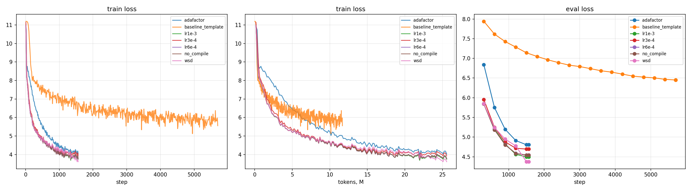

# HW1: мини-претрейн Qwen3-1B на русской Википедии


**Лучший результат: `eval_loss = 4.374`, perplexity ≈ 79.3** (WSD, lr 6e-4). Шаблонный baseline: `eval_loss = 6.450`, perplexity ≈ 632.7.


## Сетап

- **Данные:** `wikimedia/wikipedia`, `20231101.ru`. Первые 5000 примеров идут в валидацию. Train: 1 940 063, val: 5 000.
- **Токенизатор:** `ai-forever/rugpt3small_based_on_gpt2`, длина блока `MAX_LENGTH = 512` (truncation + padding до 512, на pad-токенах labels = -100).
- **Модель:** Qwen3, 12 слоёв, hidden 2048, 16 голов (8 KV), FFN 8192, FlashAttention-2, bf16. Всего 960 881 664 параметра. Архитектура не менялась.
- **Бюджет:** GPU: 1× H100 80GB 
- **Общий конфиг:** AdamW fused, weight decay 0.1, betas (0.9, 0.95), grad clip 1.0, bf16 + tf32, warmup 5%, eval и save каждые 300 шагов.

## Эксперименты

### 1. Выбор batch size (по пропускной способности)

Короткие прогоны по 40 шагов без eval и save, `torch_compile=True`, lr 6e-4:

| per_device_batch_size | tok/s (с pad) | Память, GB |
|---|---|---|
| 16 | 58.6k | 16.9 |
| 32 | 62.1k | 28.1 |
| 48 | 62.9k | 39.5 |
| 64 | 63.0k | 50.7 |

Начиная с bs=32 пропускная способность выходит на плато, а память растёт линейно. Выбран **bs = 32, grad accumulation = 1** (28 GB, разница с bs=64 около 1.3%).

### 2. Шаги

`max_steps` рассчитан по времени шага, времени компиляции и числу eval:

```
max_steps = (900 − t_compile − n_eval·t_eval − 30) / t_step = 1566
```

Это 1566 × 32 × 512 ≈ 25.7M токенов (около 2.6% эпохи). Все запуски (кроме baseline) доходят до конца расписания lr.

### 3. Основные запуски

| Эксперимент | Что менялось | Шагов | eval_loss | Perplexity | tok/s |
|---|---|---|---|---|---|
| baseline_template | bs=4, lr=5e-5, linear, warmup 200 | 5701 (таймаут) | 6.450 | 632.7 | 37.2k |
| lr3e-4 | cosine, bs=32 | 1566 | 4.695 | 109.4 | 61.7k |
| lr6e-4 | cosine, bs=32 | 1566 | 4.545 | 94.2 | 61.6k |
| no_compile | lr 6e-4, `torch_compile=False` | 1566 | 4.544 | 94.0 | 61.6k |
| lr1e-3 | cosine, bs=32 | 1566 | 4.499 | 90.0 | 61.7k |
| adafactor | `optim=adafactor`, lr 1e-3 | 1566 | 4.805 | 122.1 | 52.9k |
| **wsd** | lr 6e-4, warmup-stable-decay, decay 20% шагов | 1566 | **4.374** | **79.3** | 61.6k |

## Графики



Слева: train loss по шагам. В центре: train loss по числу токенов. Справа: eval loss по шагам.

## Наблюдения

**Baseline.** Шаблон (bs=4, lr=5e-5) не насыщает GPU (37k tok/s) и за 15 минут видит лишь 11.7M токенов. Train loss застревает около 5.8–6, а eval_loss = 6.45. На графике по токенам видно, что при равном числе токенов остальные запуски на ~1.5 nats ниже. Остальные запуски при этом использовали меньше времени, чем baseline.

**Learning rate.** При lr 3e-4, 6e-4 и 1e-3 eval_loss монотонно снижается: 4.695, 4.545, 4.499. На коротком горизонте (~2.6% эпохи) выигрывает более высокий lr. Верхняя граница не найдена: 1e-3 был максимальным значением в свипе.

**Scheduler.** WSD при том же пиковом lr 6e-4 дал −0.17 по loss (−16% по perplexity) относительно cosine. На шаге 1200 WSD был хуже cosine (~4.77 против ~4.6), но резкий спад в последних 20% шагов обогнал его к концу. Высокий lr даёт быстрый прогресс, а спад подавляет шум градиентов. Сравнение корректно только в финальной точке.

**Оптимизатор.** Adafactor хуже AdamW при том же lr 1e-3 (4.805 против 4.499), медленнее на ~14% (52.9k против 61.6k tok/s) и экономит лишь ~3.5 GB памяти. Начало обучения у него заметно медленнее: на центральном графике видно плато loss около 8.7.

**torch.compile.** Выигрыша нет: 61 584 против 61 637 tok/s, а eval_loss отличается на 0.0015. В логах предупреждение `torch._dynamo hit cache_size_limit (8)`: из-за перекомпиляций по `layer_idx` компиляция, вероятно, частично откатывается в eager. Разница 0.0015 между двумя практически идентичными запусками даёт оценку шума между прогонами: различия больше ~0.05 можно считать значимыми.

**Throughput.** Около 62k tok/s считает и pad-токены. Из-за фиксированного padding до 512 часть вычислений тратится на padding.

## Примеры генераций

Greedy и sampling (T = 0.8, top-p = 0.95), `repetition_penalty = 1.2`, 80 новых токенов. Ниже сокращённые фрагменты.

**baseline (ppl 632.7).** Бессвязный текст с повторяющимися шаблонами:

> Москва — столица. Известные носители: «Пан» () — американский фильм, за фильм «Кин-Хай». «Сюси» — американский фильм «Вор-Л»…

**wsd (ppl 79.3).** Грамматичный текст в стиле Википедии:

> Александр Сергеевич Пушкин родился в городе Санкт-Петербург, Россия. Биография. Родился в семье рабочего. В 1873 году окончил школу № 1…

**lr1e-3.**

> В 1812 году был назначен командующим войсками в составе Российской империи. […] С 16 марта 1813 года — генерал-майор. В 1814 году произведён в генерал-лейтенанты и назначен командиром 1-го армейского корпуса.

**lr6e-4, дополнительные промпты.**

> Санкт-Петербург основан в 1856 году. […]
> Физика — это наука, или для обозначения различных видов. Описание. Мелкие муравьи (длина тела) с чёрным стеблем…

**Анализ генераций:**

- Модель освоила локальную структуру языка: морфологию, согласование, типичные для Википедии рубрики («Биография», «География», «Население», «Примечания») и клише биографий и статей о сёлах.
- Фактов модель не знает: «Москва — столица Украины», Пушкин у неё «боксёр» или «футболист», Санкт-Петербург основан в 1856 году, «Искусственный интеллект — это название нескольких населённых пунктов».
- Выдача сильно смещена к самым частым типам статей русской Википедии (сёла, спортсмены, военные биографии, таксоны). После ~25M токенов это ожидаемо.
- В greedy-режиме встречаются зацикливания («библиотека, отделение, библиотека…»), несмотря на `repetition_penalty = 1.2`.

## Выводы

1. Основной вклад в качество даёт не мелкая настройка, а базовые вещи: насыщение GPU (bs=32 вместо 4), адекватный lr (6e-4…1e-3 вместо 5e-5) и расписание, доходящее до нуля к концу бюджета. Это снижает perplexity с 633 до 79–94.
2. Среди рассмотренных расписаний лучший — WSD (−16% perplexity к cosine).
3. AdamW (fused) лучше и быстрее Adafactor в этой постановке.
4. `torch.compile` в текущей конфигурации не ускоряет обучение.
5. Генерации стали «языкоподобными» и стилистически похожими на Википедию, но фактологически неверны. Для знаний нужно существенно больше токенов.


