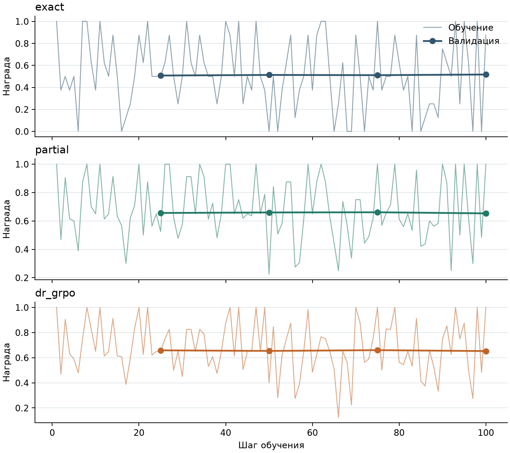

# RL для вызова инструментов

Лучший результат BFCL показал `exact` с **69.60%** при **68.53%** у базовой Qwen3.5-2B.

## Результаты BFCL

BFCL содержит 350 примеров. Overall равен среднему по пяти группам. В Multiple и Irrelevance обычная и live-категория получают одинаковый вес. Оценщик, промпты и greedy-декодирование одинаковы у всех четырёх моделей.

| Run | Overall | Simple | Multiple | Parallel | Parallel multiple | Irrelevance |
|---|---:|---:|---:|---:|---:|---:|
| `base` | 68.53% | 68.00% | 78.67% | 56.00% | 80.00% | 60.00% |
| `exact` | 69.60% | 68.00% | 80.00% | 56.00% | 80.00% | 64.00% |
| `partial` | 68.80% | 68.00% | 80.00% | 56.00% | 80.00% | 60.00% |
| `dr_grpo` | 68.53% | 68.00% | 78.67% | 56.00% | 80.00% | 60.00% |

## Данные и обучение

Из 11300 диалогов ToolACE в train вошло 9275 примеров (8056 с вызовом и 1219 без вызова), в validation — 1114 (985 с вызовом и 129 без вызова). После удаления 36 дубликатов отфильтровано 4 промпта длиннее 2048 токенов. Медиана длины промпта 655 токенов, P90 1045, максимум 1995.

Распределение train и validation фиксировалось по хешу сообщения и схем инструментов с seed 73. Обучение использовало LoRA r=16, 100 шагов, 4 генерации на запрос, максимум 512 токенов в генерации и learning rate 5e-6. Веса запускались на A100 80GB PCIe №0 devbox11. Батч валидации был 32. Во всех трёх экспериментах движок генерации rollout — vLLM в режиме colocate. Каждые 25 шагов считалась награда по четырём генерациям на каждый валидационный промпт. Для BFCL использованы объединённые веса лучшего по награде validation чекпойнта каждого запуска.

## Как изменились результаты

- **`exact` → `partial`.** Переход к частичной награде при том же GRPO со стандартизацией в группе. Overall изменился на -0.80 п. п. На уровне примеров верными стали 2 ответов, неверными — 4. Изменения по группам — `irrelevance` (-4.00 п. п.).
- **`partial` → `dr_grpo`.** Переход к Dr. GRPO при той же частичной награде. Изменились нормировка loss и масштабирование reward. Overall изменился на -0.27 п. п. На уровне примеров верными стали 1 ответов, неверными — 3. Изменения по группам — `multiple` (-1.33 п. п.).

## Валидационная награда

| Run | Шаг выбранного чекпойнта | Награда | Группы с одинаковой наградой (train) | BFCL Overall |
|---|---:|---:|---:|---:|
| `exact` | 100 | 0.5167 | 75.0% | 69.60% |
| `partial` | 75 | 0.6610 | 62.5% | 68.80% |
| `dr_grpo` | 75 | 0.6598 | 63.0% | 68.53% |

Доля групп с одинаковыми наградами при переходе от exact к partial изменилась с 75.0% до 62.5%. Значит, при частичной награде больше групп содержали ответы с разной оценкой и давали сигнал для обучения.

{width=89%}

*Динамика тренировочной и валидационной награды.*

Внутри запуска динамика награды показывает, как модель приспосабливается к своей функции на ToolACE. Сравнение моделей между запусками сделано на едином BFCL. Абсолютный уровень exact и partial reward зависит от формулы. При одинаковых наградах всех ответов в группе центрирование обнуляет advantage, поэтому группа при beta=0 не даёт сигнала policy gradient.

## Ошибки вызова инструментов

- **`base`**, 100 ошибок среди 350 примеров. Пропущенный вызов — 38, ошибка аргументов или формата — 36, лишний вызов — 16, пустой или обрезанный ответ — 6, замена или несколько ошибок в вызовах — 4.
- **`exact`**, 96 ошибок среди 350 примеров. Пропущенный вызов — 37, ошибка аргументов или формата — 35, лишний вызов — 15, пустой или обрезанный ответ — 5, замена или несколько ошибок в вызовах — 4.
- `irrelevance_233` (`exact`, `irrelevance`). Лишний вызов. Ожидалось пусто. Получено `weather_in_location`.
- `simple_241` (`exact`, `simple`). Пропущенный вызов. Ожидалось `US_President_During_Event`. Получено пусто.
- `simple_386` (`base`, `simple`). Вызов `book_hotel` выбран верно, но модель передала `room_type='luxury room'`, когда проверка ожидала `'luxury'`. Эта ошибка относится к значению аргумента.

Для повторной проверки доступны `predictions.jsonl`, `metrics.json`, история, конфигурация и выбор чекпойнта.
