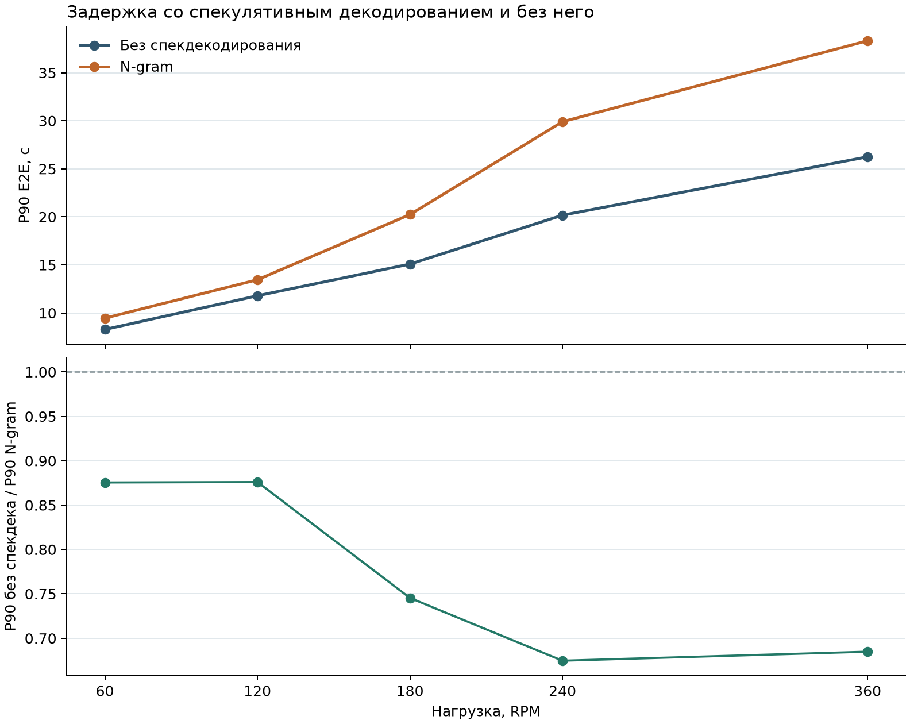
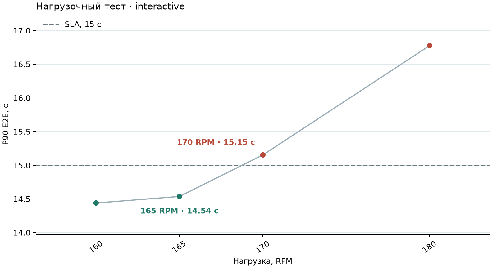

# Ускорение инференса Qwen3-8B

При 120 RPM минимальная средняя E2E-задержка составила **7.157 с** для `interactive` при **7.689 с** у baseline. Ускорение составило **1.074×**. На нагрузочном тесте SLA выполнен до **165 RPM** из проверенных точек.

## Методика

Все результаты получены на A100 80GB PCIe №0 на devbox11. Один экземпляр vLLM 0.22.0, AIPerf 0.13.0, Qwen/Qwen3-8B ревизии `b968826d9c46dd6066d109eabc6255188de91218`. Во всех запросах отключён thinking, температура 0, seed 42, максимум 512 токенов. AIPerf подавал неизменённые тела запросов из `data/requests.jsonl` последовательно с постоянным интервалом и потоковой выдачей ответа.

Префиксный кеш сбрасывался перед каждым запуском AIPerf и после него. Каждый запуск делал 40 запросов прогрева, а затем считал метрики по основной фазе. E2E измеряется от начала запроса до последнего содержательного фрагмента ответа. Выход модели мог завершиться по EOS раньше лимита 512.

## 1. Замеры при 120 RPM

Во всех строках этого этапа один и тот же набор из 640 запросов. Ускорение S равно средней E2E baseline, делённой на среднюю E2E конфигурации.

| Конфигурация | Параметры | Запросы | Ошибки | Mean E2E, с | P90 E2E, с | S |
|---|---|---:|---:|---:|---:|---:|
| `baseline` | Параметры сервера по умолчанию | 640 | 0 | 7.689 | 11.017 | 1.000× |
| `prefill1024` | `--max-num-batched-tokens 1024` | 640 | 0 | 7.749 | 11.023 | 0.992× |
| `interactive` | `--performance-mode interactivity` | 640 | 0 | 7.157 | 9.889 | 1.074× |
| `plain_v1` | Model Runner V1, без async scheduling и спекдекодирования | 640 | 0 | 8.751 | 12.634 | 0.879× |
| `ngram` | Model Runner V1, N-gram с окном 2-5 и до 4 токенов за шаг | 640 | 0 | 9.019 | 13.733 | 0.853× |

Переход к бюджету 1024 дал 7.749 с в среднем. При этом средний TTFT вырос с 133.8 до 143.0 мс. При меньшем бюджете длинные промпты чаще приходится разбивать на несколько шагов prefill.

В режиме interactivity TTFT составил 132.3 мс, близко к baseline. Средний интервал между токенами снизился с 17.91 до 16.65 мс. Длина ответов была примерно одинаковой, поэтому это согласуется с тем, что выигрыш в E2E пришёлся главным образом на декодирование.

## 2. Спекулятивное декодирование

Сопоставлены `plain_v1` и `ngram`. N-gram в vLLM 0.22.0 требует Model Runner V1, поэтому обе конфигурации этой серии используют V1. N-gram автоматически отключает async scheduling, поэтому в контрольной конфигурации он тоже отключён. Подбор кандидатов использует совпадения n-грамм в контексте запроса. Qwen3-8B проверяет предложенные токены. Серия использует по 160 запросов из одного и того же последовательного набора на каждом RPM. Столбец принятия токенов взят из счётчиков vLLM и включает прогрев.

| RPM | P90 без спекдека, с | P90 N-gram, с | Отношение P90 | Принятые токены N-gram |
|---:|---:|---:|---:|---:|
| 60 | 8.281 | 9.458 | 0.876× | 24.5% |
| 120 | 11.788 | 13.457 | 0.876× | 24.3% |
| 180 | 15.087 | 20.240 | 0.745× | 25.2% |
| 240 | 20.171 | 29.899 | 0.675× | 24.5% |
| 360 | 26.246 | 38.327 | 0.685× | 24.1% |

N-gram уступил `plain_v1` по P90 на всех проверенных нагрузках, начиная с **60 RPM**.

При 60 RPM разница по P90 составила 1.18 с, при 360 RPM она выросла до 12.08 с. В последней точке средний ITL увеличился с 46.35 до 67.06 мс при близких средних длинах ответа (418 и 421 токенов). Из предложенных токенов принято 24.1%. Стоимость построения и проверки кандидатов, по-видимому, оказалась выше экономии от принятых токенов. При высокой нагрузке разница усилилась. [Параметры спекдекодирования vLLM 0.22.0](https://docs.vllm.ai/en/v0.22.0/features/speculative_decoding/)

## 3. Нагрузочный тест

Лучшая по средней задержке конфигурация `interactive` проверена скриптом `load_test.sh`. Нагрузку подавали 300 секунд, затем клиент дождался ответов. Для зачёта точки требовались P90 < 15 с, отсутствие ошибок и число завершённых запросов в пределах двух от 5 × RPM. Между проходящей и непроходящей точками RPM уточнялся шагом 5.

| Задано, RPM | Ответы | Ошибки | Mean E2E, с | P90 E2E, с | SLA |
|---:|---:|---:|---:|---:|---|
| 160 | 800 | 0 | 9.853 | 14.440 | выполнен |
| 165 | 824 | 0 | 10.175 | 14.537 | выполнен |
| 170 | 849 | 0 | 10.721 | 15.153 | нарушен |
| 180 | 899 | 0 | 11.505 | 16.776 | нарушен |

Подтверждённая точка — **165 RPM**, P90 **14.537 с**. При **170 RPM** P90 составил **15.153 с**. Граница относится к этому серверу, данному набору запросов и проверенной сетке RPM.
